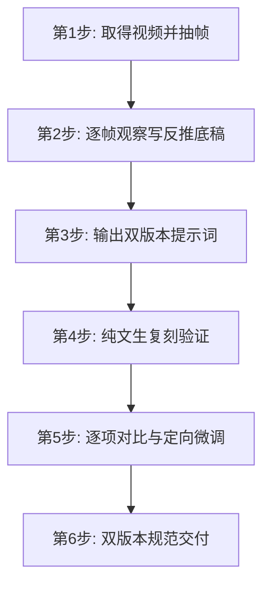

# Video Prompt Reverser (视频反推提示词)

> 🎯 **从已有视频逆向还原出高保真、可复刻的文生视频提示词，并完成纯文生闭环验证。**

`video-prompt-reverser` 是一套面向 AI 视频创作的提示词逆向反推技能规范与配套工具库。支持将任意给定的本地或在线视频，通过逐秒/均匀抽帧、切点检测、结构化特征解析、易漏项自查，从**画面风格调色、人物表情、逐拍动作、机位景别焦段、运镜轨迹、切镜转场、光线色彩、台词声音**全方位逆向还原，标准化生成**通用跨平台版（中/英）**与**豆包五段式版**两套提示词，并配套闭环复刻与对比达标方法论。

---

## ✨ 核心特性

- 🔍 **智能元数据探针、自适应抽帧与切点检测**：内置轻量 Python 工具，基于 `ffprobe` / `ffmpeg` 自动提取画幅比例、帧率、时长及音频流状态，支持按固定 FPS 或指定总帧数均匀抽帧；`detect_cuts.py` 用场景分阈辅助定位硬切时间点，供多镜头互证。
- 🎨 **全方位复刻观察（绝不脑补）**：严格遵循 A–J 节观察清单（全片风格色板、人物身份绑定、机位景别焦段、表情眉眼嘴、动作逐拍、运镜轨迹、切镜承接、光色、台词声音、节奏尾态与易漏项自查），只记录真实画面与音轨信息，排除主观套路与作者意图臆想；标准术语统一取自 `cinematic-vocabulary.md`。
- 🎭 **双版本提示词双轨交付**：
  - **通用可移植版（中 / 英双语）**：符合主流文生视频模型（即梦 Jimeng、可灵 Kling、Runway Gen-3、Pika 等）的提示词句式标准。
  - **豆包五段式版**：专为纯文生视频复刻优化的结构化模板（0秒基准 / 主体表情绑定 / 逐段动作表情声音 / 转场尾态 / 一致性禁区）。
- 🔄 **闭环复刻对比与定向迭代**：推行“反推 → 纯文生复刻 → 抽帧核对 → 局部定向修整”的标准达标闭环，拒绝无效全盘重写。
- 🎬 **复杂视频分级路由与跨镜连续性**：对单镜头、多镜头硬切、转场、人物台词及超长片进行可行性三级划分（高/中/低），支持按分镜分段拆解；统一人物身份、左右方向、光色与运动接续，按分镜表输出逐镜提示词。

---

## 📁 目录结构

```text
video-prompt-reverser/
├── SKILL.md                          # Agent Skill 核心定义与标准闭环规范
├── scripts/
│   ├── extract_frames.py             # 视频元数据解析与智能抽帧脚本
│   └── detect_cuts.py                # 场景分阈辅助检测硬切时间点
├── references/
│   ├── observation-checklist.md      # A–J 全方位逐帧反推观察清单与易漏项自查表
│   ├── cinematic-vocabulary.md       # 景别/机位/焦段/运镜/切镜/表情/光线/调色标准术语表
│   ├── prompt-templates.md           # 通用中英 & 豆包五段式提示词标准模板、分镜表与迭代准则
│   ├── complex-multi-shot.md        # 多镜头 / 切点 / 跨镜连续性 / 转场 / 人物对白 / 长片分级策略
│   └── worked-example-coffee.md      # 窗边爱心拉花拿铁标准全流程达标样例
├── .gitignore                        # Git 忽略配置
└── README.md                         # 项目使用与架构说明
```

---

## 🚀 快速上手

### 1. 前置依赖

运行配套脚本需要系统已安装 `Python 3.8+` 以及 `ffmpeg` / `ffprobe`：

```bash
# macOS (Homebrew)
brew install ffmpeg

# Ubuntu / Debian
sudo apt-get update && sudo apt-get install -y ffmpeg

# Windows (Scoop / Chocolatey)
scoop install ffmpeg
```

### 2. 视频元数据解析与抽帧

使用 `scripts/extract_frames.py` 进行快速抽帧：

```bash
# 默认按每秒 1 帧抽取（适合常规短视频）
python3 scripts/extract_frames.py path/to/video.mp4 --out frames --fps 1

# 指定总帧数均匀抽帧（适合长视频或多镜头快速巡检）
python3 scripts/extract_frames.py path/to/video.mp4 --out frames --count 12
```

**输出示例**：
```text
=== 元数据 ===
duration_s: 5.06
width: 720
height: 1280
ratio: 720:1280
fps: 24/1
nb_frames: 121
has_audio: True
audio_codec: aac

=== 已抽取 6 帧 -> /path/to/frames ===
f_01.jpg
f_02.jpg
...
```

### 3. 切点检测（多镜头片）

```bash
# 场景分阈辅助定位硬切；漏检调低 --threshold，误检调高
python3 scripts/detect_cuts.py path/to/video.mp4 --threshold 0.2 --min-gap 0.4
```

候选切点需与抽帧肉眼互证；叠化/淡入淡出等软转场不会被硬切阈值捕获。

---

## 🛠️ 标准反推与复刻 6 步工作流



1. **取得视频并抽帧**：使用 `extract_frames.py` 提取时长、画幅、帧率与音频元数据及关键帧。
2. **逐帧观察，写反推底稿**：按照 [`references/observation-checklist.md`](references/observation-checklist.md) 记录全片风格色板、人物身份绑定、机位景别焦段、表情、动作逐拍、运镜轨迹、切镜承接、光色、台词声音、节奏与易漏项（朝向、光向、运镜、动作方向、表情等）。复杂片先查阅 [`references/complex-multi-shot.md`](references/complex-multi-shot.md)，术语取自 [`references/cinematic-vocabulary.md`](references/cinematic-vocabulary.md)。
3. **反推双版本提示词**：按照 [`references/prompt-templates.md`](references/prompt-templates.md) 同时产出**通用可移植版（中/英）**与**豆包五段式版**。
4. **纯文生复刻**：使用提示词在文生视频模型进行纯文生生成，严格保持画幅比例与时长一致。
5. **对比与迭代**：将复刻片与原片逐项比对，核心要素（主体外观、表情、主动作、光向、机位景别、运镜、画幅时长、风格氛围）未命中时集中微调对应行，直至达标。
6. **标准化交付**：向用户交付两套干净提示词、复刻对照表及分镜说明。

---

## 📝 提示词规范示例

以经典的“窗边爱心拉花拿铁”为例（完整案例见 [`references/worked-example-coffee.md`](references/worked-example-coffee.md)）：

### 通用可移植版（中文）

> 竖屏9:16，5秒治愈系静物氛围镜头，无人物、无文字、无对白。清晨金色阳光从左侧落地窗低角度斜射进入室内，形成柔和金色光柱；一只奶白色圆润陶瓷拿铁杯置于纵向原木拼接桌面，C形杯把朝画面右侧，奶泡表面是对称的多层同心圆爱心形拉花；杯口升起一缕白色热气，呈S形双螺旋缓缓上升、向画面右上方飘散变淡。机位略高于杯口、轻微俯视，镜头从杯中近景全程匀速极缓慢向前推近至近景；浅景深，背景是虚化的窗边绿植、窗台小盆栽与暖棕墙面，暖橙金色调，柔和侧逆光，空气中漂浮细微光点，安静温馨，细腻胶片质感。

### 豆包五段式版（纯文生复刻最佳）

```text
【第1段 输入资产定位与 0 秒基准】
纯文生无参考图；竖屏9:16，杯中近景，奶白陶瓷拿铁杯居中偏下、杯把朝右，原木桌面，爱心拉花，左侧金色晨光就位，背景虚化，杯口刚升起细白热气。

【第2段 参考主体绑定与生成目标】
锁定奶白厚实陶瓷杯、C形杯把朝右、多层同心圆爱心拉花、纵向原木桌面；目标复现“窗边爱心拿铁、螺旋热气、缓慢推近”治愈氛围，禁止人物/文字/logo/对白。

【第3段 逐时间段动作、声音与脚本】
0–1s 细白热气盘小螺旋，镜头起始缓推，氛围音无人声；
1–3s 热气舒展S双螺旋，匀速缓推、杯子占比增大，氛围音无人声；
3–5s 热气右上飘散变淡，推至近景拉花饱满，氛围音收轻，无人声。

【第4段 转场与尾态收束】
单镜头无切镜无转场；停近景爱心拉花，热气淡散，无slogan文字。

【第5段 全片一致性与禁区】
保持奶白杯、杯把恒朝右、左来金光、暖橙金、浅景深；
禁止人物/手部/文字/水印/logo/对白/环绕/右侧打光/直烟/普通奶泡/冷色。
```

---

## ⚠️ 适用边界与非支持项

- **纯文生聚焦**：默认采用纯文本生成验证。除非用户明确提供首帧参考图，否则不依赖图生视频。
- **不替代后期剪辑**：对于包含多次硬切、复杂画中画、精确对白口型或特效转场的长片，本工具负责输出**分镜头表与逐镜提示词**，拼接与配音需由剪辑流程完成。
- **真实人物与品牌合规**：原片涉及真人、品牌商标或受保护版权内容时，提示词仅提炼构图、风格与物理动力学特征，不还原具体面容与注册标识。

---

## 📄 License

[MIT License](LICENSE) (或参照项目许可声明)
